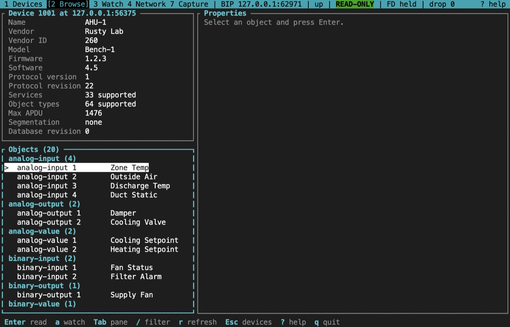

# Rusty BACnet

A BACnet protocol stack written in Rust, with Python bindings, a command-line
tool with a terminal UI, and an MCP server for AI agent hosts. Use it to build
BACnet clients, model devices and serve their objects, or explore a network in a
local lab. It targets ASHRAE Standard 135-2020 and isn't BTL certified.

[](https://crates.io/crates/bacnet-client)
[](https://pypi.org/project/rusty-bacnet/)
[](https://docs.rs/bacnet-client)
[](LICENSE)

**[Documentation](https://jscott3201.github.io/rusty-bacnet/)** ·
**[Rust API](https://docs.rs/bacnet-client)** ·
**[Python API](docs/python-api.md)**

> [!NOTE]
> The latest release is **0.14.0**; the packages, the hosted guides and docs.rs
> describe it. This README and [`docs/`](docs/) follow the `dev` branch, which
> may be ahead. Rusty BACnet is pre-1.0: public APIs can change in any minor
> release.

> [!IMPORTANT]
> Use it only on networks and devices you are authorized to access. Discovery
> sends traffic, and writes and device management change real equipment. Start
> on loopback, as below.

## What you can build

| Surface | What it gives you | Start here |
|---|---|---|
| Rust client and server | Tokio roles: discovery, segmentation, COV, alarms, and an object database with the standard object types | [Rust guide](https://jscott3201.github.io/rusty-bacnet/start/rust/) |
| Python (asyncio) | Client, server and SC hub, with typed values and COV streams | [Python guide](https://jscott3201.github.io/rusty-bacnet/start/python/) |
| `bacnet` CLI and terminal UI | One-shot commands with JSON output; a full-screen browser, watch list and guarded writes | [CLI reference](docs/CLI.md), [terminal UI](https://jscott3201.github.io/rusty-bacnet/tui/overview/) |
| MCP server (new on `dev`) | Read-only tools for AI agent hosts, live only on a profile a person authorized | [AI agents guide](https://jscott3201.github.io/rusty-bacnet/guides/ai-agents/) |
| Shared endpoints | One transport that both sends requests and answers a few | [Shared endpoints](https://jscott3201.github.io/rusty-bacnet/integrate/shared-endpoints/) |
| Routing and BBMD | A router between networks and transports; BBMDs and foreign devices | [Router guide](https://jscott3201.github.io/rusty-bacnet/integrate/router/) |
| Embedded `no_std` cores | MS/TP, BACnet/IP and routing without an allocator | [Embedded guide](https://jscott3201.github.io/rusty-bacnet/start/embedded/) |

## Quickstart

These examples run on loopback. Start the server in one terminal and leave it
running, then read from it in a second terminal. [Install](#install) the
Python package first.

### 1. Run a local server (Python)

Save this as `local_server.py` and run `python local_server.py`. Stop it with
**Ctrl+C**.

```python
# local_server.py: one simulated temperature sensor on 127.0.0.1:47808
import asyncio
from rusty_bacnet import BACnetServer


async def main():
    server = BACnetServer(
        device_instance=1234,
        device_name="Local BACnet lab",
        interface="127.0.0.1",
        port=47808,
        broadcast_address="127.0.0.1",
    )
    # Units 62 = degrees Celsius. Add objects before starting the server.
    server.add_analog_input(1, "Zone temperature", units=62, present_value=22.5)
    try:
        await server.start()
        print(f"Listening at {await server.local_address()}", flush=True)
        await asyncio.Event().wait()
    finally:
        await server.stop()


if __name__ == "__main__":
    try:
        asyncio.run(main())
    except KeyboardInterrupt:
        pass
```

Before you leave loopback, pick a device instance that is unique on your
network.

### 2. Read a property

**Python:**

```python
# read_value.py: read Analog Input 1's present value
import asyncio
from rusty_bacnet import BACnetClient, ObjectIdentifier, ObjectType, PropertyIdentifier


async def main():
    # Port 0 picks a free local port, so it doesn't clash with the server.
    async with BACnetClient(
        interface="127.0.0.1", port=0, broadcast_address="127.0.0.1"
    ) as client:
        value = await client.read_property(
            "127.0.0.1:47808",
            ObjectIdentifier(ObjectType.ANALOG_INPUT, 1),
            PropertyIdentifier.PRESENT_VALUE,
        )
        print(value.value)  # 22.5


asyncio.run(main())
```

**Rust:** create a project with `cargo new`, add the dependencies from
[Install](#rust), replace `src/main.rs` with this, then `cargo run`:

```rust
use bacnet_client::client::BACnetClient;
use bacnet_encoding::primitives::decode_application_value;
use bacnet_types::enums::{ObjectType, PropertyIdentifier};
use bacnet_types::primitives::ObjectIdentifier;
use std::net::Ipv4Addr;

#[tokio::main]
async fn main() -> Result<(), Box<dyn std::error::Error>> {
    let oid = ObjectIdentifier::new(ObjectType::ANALOG_INPUT, 1)?;
    let mut client = BACnetClient::bip_builder()
        .interface(Ipv4Addr::LOCALHOST)
        .port(0)
        .broadcast_address(Ipv4Addr::LOCALHOST)
        .build()
        .await?;

    // A BACnet/IP address: four IPv4 octets, then the UDP port (0xBAC0 = 47808).
    let address = [127, 0, 0, 1, 0xBA, 0xC0];
    let response = client
        .read_property(&address, oid, PropertyIdentifier::PRESENT_VALUE, None)
        .await;
    client.stop().await?;

    let ack = response?;
    let (value, _) = decode_application_value(&ack.property_value, 0)?;
    println!("{value:?}");
    Ok(())
}
```

**CLI:**

```bash
bacnet --interface 127.0.0.1 --port 0 read 127.0.0.1:47808 ai:1 pv
bacnet --interface 127.0.0.1 --port 0 --json readm 127.0.0.1:47808 ai:1 pv,object-name
```

`ai:1` is Analog Input 1 and `pv` is Present_Value. The
[local lab](https://jscott3201.github.io/rusty-bacnet/start/local-lab/) goes
further, and [`examples/`](examples/) has complete Rust, Python and Docker
setups.

## Tour

### Serve objects from Rust

A device with an analog input and a binary output that peers can command. It
uses the dependencies from [Install](#rust).

```rust
use bacnet_objects::DeviceIdentity;
use bacnet_objects::analog::AnalogInputObject;
use bacnet_objects::binary::BinaryOutputObject;
use bacnet_objects::database::ObjectDatabase;
use bacnet_objects::device::{DeviceConfig, DeviceObject};
use bacnet_server::server::BACnetServer;
use bacnet_types::enums::EngineeringUnits;
use std::net::Ipv4Addr;

#[tokio::main]
async fn main() -> Result<(), Box<dyn std::error::Error>> {
    // Vendor 0 is a placeholder: use the identifier ASHRAE assigned you.
    let identity = DeviceIdentity::new(1001, 0)?.with_name("Example air handler");
    let mut database = ObjectDatabase::new();
    database.add(Box::new(DeviceObject::new(DeviceConfig {
        identity: identity.clone(),
        ..DeviceConfig::default()
    })?))?;
    let mut supply = AnalogInputObject::new(1, "Supply air", EngineeringUnits::DEGREES_CELSIUS)?;
    supply.set_present_value(21.5);
    database.add(Box::new(supply))?;
    // Peers command the fan through its priority array.
    database.add(Box::new(BinaryOutputObject::new(1, "Supply fan")?))?;

    let mut server = BACnetServer::bip_builder()
        .device(identity)
        .interface(Ipv4Addr::LOCALHOST)
        .port(47809)
        .broadcast_address(Ipv4Addr::LOCALHOST)
        .database(database)
        .build()
        .await?;
    println!("Serving device 1001 on 127.0.0.1:47809; press Ctrl+C to stop");
    tokio::signal::ctrl_c().await?;
    server.stop().await?;
    Ok(())
}
```

More: the [server guide](https://jscott3201.github.io/rusty-bacnet/integrate/server/)
and [`docs/rust-api.md`](docs/rust-api.md).

### Watch a value from Python

Subscribe to change-of-value (COV) notifications from the quickstart server.
The server reports the current value at once, then each change.

```python
# watch_value.py: subscribe to Analog Input 1 and print its first notification
import asyncio
from rusty_bacnet import BACnetClient, ObjectIdentifier, ObjectType


async def main():
    sensor = ObjectIdentifier(ObjectType.ANALOG_INPUT, 1)
    async with BACnetClient(
        interface="127.0.0.1", port=0, broadcast_address="127.0.0.1"
    ) as client:
        # Listen before subscribing, so the first notification isn't missed.
        notifications = await client.cov_notifications()
        await client.subscribe_cov(
            "127.0.0.1:47808",
            subscriber_process_identifier=1,
            monitored_object_identifier=sensor,
            confirmed=False,
            lifetime=60,  # seconds
        )
        async for notification in notifications:
            for change in notification.values:
                print(change["property_id"], change["value"].value)
            break  # the subscription lapses after its lifetime


asyncio.run(main())
```

More: [observing changes](https://jscott3201.github.io/rusty-bacnet/guides/observe-changes/)
and [`docs/python-api.md`](docs/python-api.md).

### Browse in the terminal UI

Plain `bacnet` on a terminal opens the terminal UI at its profile manager,
where you save B/IP, BACnet/SC and MS/TP connections. Transport flags without
a profile connect at once, here on loopback. It is read-only until you arm a
write session.

```sh
bacnet
bacnet tui --interface 127.0.0.1 --port 0 --broadcast 127.0.0.1
```

It discovers devices, browses their objects and properties, keeps a watch
list, and shows BBMD, router, BACnet/SC and MS/TP diagnostics.



More: the [terminal UI guide](https://jscott3201.github.io/rusty-bacnet/tui/overview/).

### Let an AI agent read a site (MCP)

New on `dev` for 0.15. `bacnet mcp serve` is a Model Context Protocol server
that an agent host, such as Claude Code, starts as a child process. Its tools
discover devices, list and find objects, read properties, trend logs and
alarms, and decode captured frames. It is **read-only**: it offers no tool
that writes. The release executables leave it out, so build the CLI with the
`mcp` feature:

```sh
cargo install --path crates/bacnet-cli --locked --features mcp
```

Live traffic needs a [TUI profile](https://jscott3201.github.io/rusty-bacnet/tui/profiles/),
whose `[mcp]` table limits the networks and devices an agent may reach. A
person authorizes it once in a terminal; widening the table or changing the
transport later clears that.

```sh
bacnet mcp authorize --profile plant-a
```

Then point the agent host at it. For Claude Code, in a project's `.mcp.json`:

```json
{
  "mcpServers": {
    "bacnet": {
      "command": "bacnet",
      "args": ["mcp", "serve", "--stdio", "--profile", "plant-a"]
    }
  }
}
```

Without a profile, only `--passive` runs: it sends nothing, and offers only
the empty discovery table and the frame decoder.

```sh
bacnet mcp serve --stdio --passive
```

More: the [AI agents guide](https://jscott3201.github.io/rusty-bacnet/guides/ai-agents/)
and [`docs/mcp.md`](docs/mcp.md).

## Install

The [installation guide](https://jscott3201.github.io/rusty-bacnet/start/installation/)
lists every platform, wheel and checksum step.

### Python

```bash
python -m pip install rusty-bacnet
```

This needs Python 3.11 or newer; the import name is `rusty_bacnet`. Wheels
cover CPython 3.11 to 3.14 on Linux, macOS and Windows.

### Rust

Add only the crates you need. These cover the examples above:

```toml
[dependencies]
bacnet-client = "0.14"
bacnet-encoding = "0.14"
bacnet-objects = "0.14"
bacnet-server = "0.14"
bacnet-types = "0.14"
tokio = { version = "1", features = ["macros", "rt-multi-thread", "signal"] }
```

The 0.14 release needs Rust 1.93. A `dev` checkout needs Rust 1.95;
[build from source](https://jscott3201.github.io/rusty-bacnet/development/build-from-source/)
covers it.

### CLI

Download the `bacnet-<os>-<arch>` executable for your platform from the
[latest release](https://github.com/jscott3201/rusty-bacnet/releases/latest),
check it against `SHA256SUMS`, and put it on your `PATH` as `bacnet`. Or
build it with Cargo:

```bash
cargo install bacnet-cli --locked --features sc-tls
```

## Transports

BACnet/IP is always built; the others are Cargo features of
`bacnet-transport`. `bacnet-client` also has `ipv6` and `sc-tls`, and
`bacnet-server` and `bacnet-endpoint` have `sc-tls`. The Python package has
every transport but Ethernet.

| Transport | Feature | Note |
|---|---|---|
| BACnet/IP | none | BBMD, foreign devices, a BBMD behind NAT, multicast |
| BACnet/IPv6 | `ipv6` | Keeps to one concrete interface and address |
| BACnet/SC | `sc-tls` | Nodes, direct connections and a hub over TLS 1.3 |
| MS/TP | `serial` | Standard and extended frames; on-wire timing not qualified |
| Ethernet | `ethernet` | Linux only; needs `CAP_NET_RAW` |

More: the [transport matrix](https://jscott3201.github.io/rusty-bacnet/reference/transports/)
and the [connection guides](https://jscott3201.github.io/rusty-bacnet/connect/overview/).

## Crates

Depend on the highest layer that covers your task. The
[crate map](https://jscott3201.github.io/rusty-bacnet/reference/rust/) lists
each crate's purpose, features and dependencies.

- **Codecs and cores** (`no_std`, no allocator): `bacnet-time`, `bacnet-npdu`,
  `bacnet-mstp-codec`, `bacnet-bip-codec`, `bacnet-mstp-core`,
  `bacnet-bip-core`, `bacnet-router-core`.
- **Protocol** (`no_std` with or without an allocator): `bacnet-types`,
  `bacnet-encoding`, `bacnet-services`.
- **Transports and network:** `bacnet-transport`, `bacnet-network`.
- **Roles:** `bacnet-objects`, `bacnet-client`, `bacnet-server`,
  `bacnet-endpoint-core`, `bacnet-endpoint`.
- **Tools:** `bacnet-cli` (the `bacnet` executable), and, new on `dev`,
  `bacnet-ops` (the operations core the CLI, TUI and MCP server share) and
  `bacnet-mcp`.
- **Python:** [`crates/rusty-bacnet`](crates/rusty-bacnet), built with
  [maturin](https://www.maturin.rs/).

The [architecture notes](docs/architecture.md) show how the layers fit together.

## Find it in the docs

The [website](https://jscott3201.github.io/rusty-bacnet/) covers the 0.14.0
release. The [`docs/`](docs/) references track `dev`.

| Topic | Where to look |
|---|---|
| First steps | [Choose your path](https://jscott3201.github.io/rusty-bacnet/start/choose-your-path/), [local lab](https://jscott3201.github.io/rusty-bacnet/start/local-lab/) |
| Connecting | [Connection guides](https://jscott3201.github.io/rusty-bacnet/connect/overview/): BACnet/IP, IPv6, SC, MS/TP, BBMDs, NAT |
| Building on it | [Integration guides](https://jscott3201.github.io/rusty-bacnet/integrate/overview/): servers, routers, shared endpoints, security |
| Writes | [Safe writes](https://jscott3201.github.io/rusty-bacnet/guides/safe-writes/), [mutation policy](docs/mutation-policy.md) |
| API references | [Rust](docs/rust-api.md), [Python](docs/python-api.md), [CLI](docs/CLI.md), [MCP](docs/mcp.md) |
| Policies and limits | [Engineering docs index](docs/README.md) |
| Upgrading | [Upgrade guide](https://jscott3201.github.io/rusty-bacnet/project/upgrading/), [changelog](CHANGELOG.md) |
| Problems | [Troubleshooting](https://jscott3201.github.io/rusty-bacnet/help/troubleshooting/) |

## Status and conformance

Rusty BACnet is **not BTL certified** and claims no full conformance;
[What's supported](https://jscott3201.github.io/rusty-bacnet/project/support/#whats-supported)
lists the object types, services and transports it implements.

## Roadmap

Planned work is on the public
**[Rusty BACnet Roadmap](https://github.com/users/jscott3201/projects/4)**
board, by track, priority and target release. Releases have no dates: each
ships when its milestone is done.

## Contributing

Bug reports, test cases, documentation fixes and focused patches are welcome.
[CONTRIBUTING.md](CONTRIBUTING.md) has the pull request flow,
[support](https://jscott3201.github.io/rusty-bacnet/project/support/#report-a-problem)
says what an issue needs, and [`docs/ci.md`](docs/ci.md) lists every check CI
runs.

```bash
git clone https://github.com/jscott3201/rusty-bacnet.git
cd rusty-bacnet
cargo install cargo-nextest --locked
cargo build --locked
cargo nextest run --workspace --exclude rusty-bacnet --locked
cargo test --doc --workspace --exclude rusty-bacnet --locked
```

nextest (0.9.145 or newer) skips doctests, so `cargo test --doc` runs them.
For the Python bindings (on Windows, activate with `.venv\Scripts\activate`;
the BACnet/SC tests also need the `openssl` command):

```bash
python -m venv .venv && source .venv/bin/activate
python -m pip install "maturin>=1,<2"
maturin develop --manifest-path crates/rusty-bacnet/Cargo.toml --locked
python -m unittest discover -s crates/rusty-bacnet/tests
```

Report security vulnerabilities privately, as the
[security policy](.github/SECURITY.md) describes.

## License

[MIT](LICENSE)
